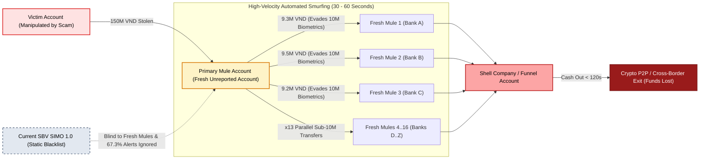
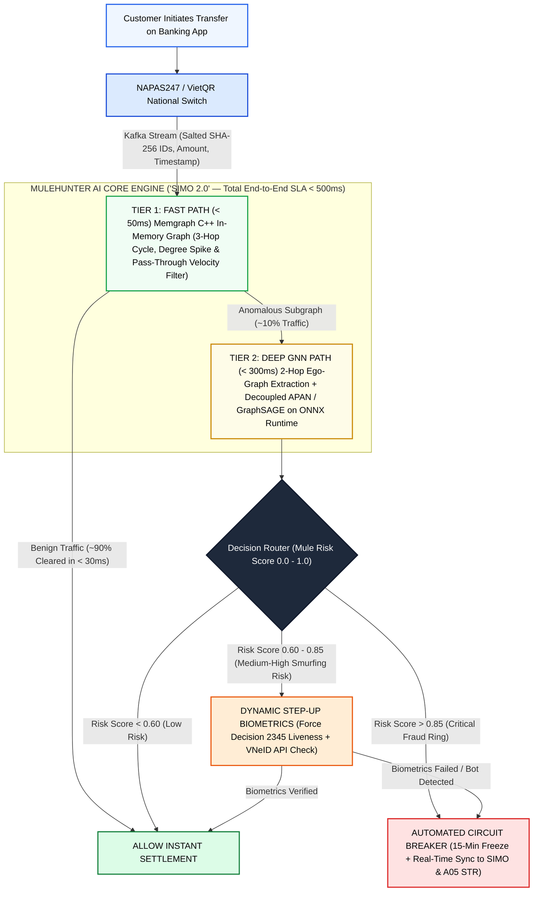
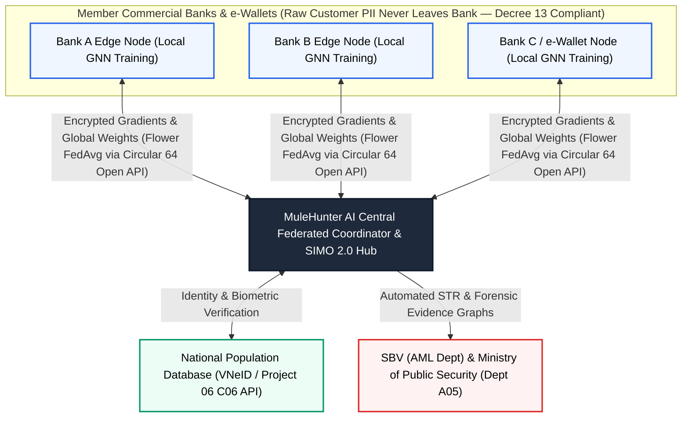
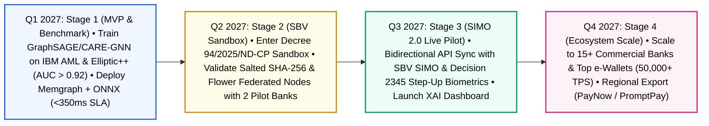
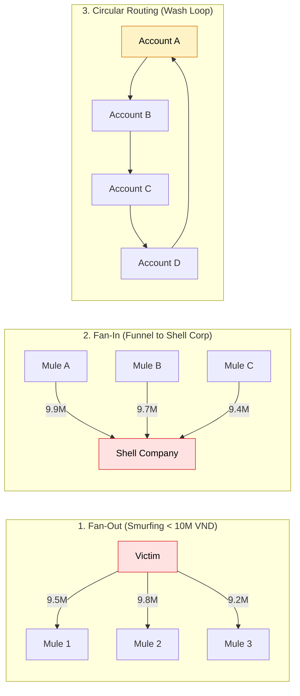

# BỘ SƠ ĐỒ TRỰC QUAN (MERMAID DIAGRAMS) — TEAM TCQL (RMIT HACK-A-VENTURE 2026)

## Sơ đồ 1: Luồng Tấn công Chia nhỏ Tiền (Smurfing) & Lỗ hổng của Hệ thống SIMO 1.0 Hiện tại
*(Chèn vào **Mục 2.2. Problem Statement & Market Pain**)*

---

## Sơ đồ 2: Kiến trúc Tổng thể 2 Tầng & Luồng Xử lý Thời gian thực (< 500ms SLA)
*(Chèn vào **Mục 2.3. Solution Architecture & FinTech Integration**)*

---

## Sơ đồ 3: Mô hình Học liên kết Bảo mật (Federated Graph Learning) & Liên thông Open API
*(Chèn vào **Mục 2.3. Open Innovation & Privacy Mitigation**)*

---

## Sơ đồ 4: Lộ trình Triển khai Hàng quý (Visual Quarterly Implementation Roadmap)
*(Chèn vào **Mục 2.6. Implementation Roadmap & Scalability**)*

---

## Sơ đồ 5: 4 Hình thái Đồ thị Rửa tiền (Money Laundering Topologies)
*(Chèn vào **Mục 2.8. Appendix A**)*

